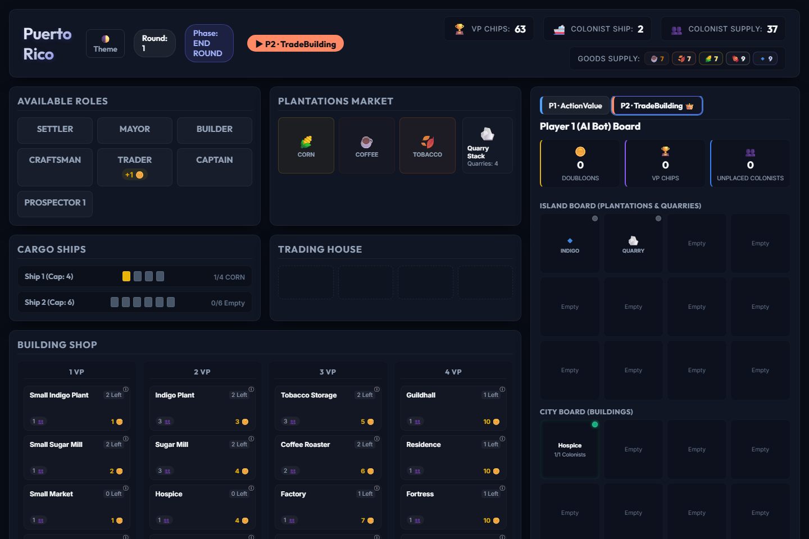

# Puerto Rico AI Competition

[](https://github.com/dae-hany/PuertoRico_AI_Competition/actions/workflows/tests.yml)
[](https://colab.research.google.com/github/dae-hany/PuertoRico_AI_Competition/blob/main/examples/first_agent.ipynb)

[English](README.md)

이 저장소는 경제 전략 보드게임인 Puerto Rico를 기반으로 하는 AI 대회입니다.
Puerto Rico는 강화학습과 게임 AI의 벤치마크로 제안된 게임입니다. 참가자가
에이전트를 작성하면 그 에이전트가 다른 에이전트와 게임을 끝까지 진행하고,
토너먼트가 모든 참가자의 순위를 산출합니다.

대회는 서로 독립된 두 트랙으로 진행되며, 트랙마다 리더보드가 따로 있습니다.

- **2p 트랙**: 1대1(2인) Puerto Rico입니다.
- **3p 트랙**: 3인 Puerto Rico입니다.

한 트랙에만 참가해도 되고 두 트랙에 모두 참가해도 됩니다. 다만 트랙마다
제출물을 따로 내야 합니다. 여러 차이 가운데 하나로, 관측 벡터의 길이가
트랙마다 다르기 때문입니다(2p는 225, 3p는 298). 그 밖의 규칙과 엔진,
행동 공간은 두 트랙이 공유합니다.

현재 진행 중인 대회는 전남대학교 강화학습 수업의 기말 프로젝트입니다(2p 트랙,
2026년 가을학기). 수강생이라면 [docs/COURSE_CNU_2026.ko.md](docs/COURSE_CNU_2026.ko.md)
([English](docs/COURSE_CNU_2026.md))를 확인해 주십시오. 같은 엔진과 같은 기술
규칙으로 공개 대회인 IEEE CoG 2027 에디션도 계획되어 있으며, 일정은 이 페이지에서
공지합니다. 누구나 참가할 수 있도록 엔진과 에이전트, 문서는 영어로 작성되어
있습니다. 한국어판이 있는 문서는 이 README와 수업 안내 문서뿐입니다. 엔진은 표준 [PettingZoo](https://pettingzoo.farama.org/) AEC 환경
(`puerto_rico/env.py`)이므로, 멀티에이전트 강화학습 도구로 바로 제어할 수
있습니다.

**처음이신가요?** 가장 빠른 시작 방법은
[`examples/first_agent.ipynb`](examples/first_agent.ipynb) 노트북입니다(위의
배지를 누르면 Colab에서 열립니다). 아무것도 설치하지 않고 약 10분 안에
에이전트를 작성하고, 베이스라인과 대전시키고, 게임을 리플레이로 다시 볼 수
있습니다.

> 왜 대회인가요? Puerto Rico는 시뮬레이션하기는 쉽지만 숙달하기는 어려운
> 게임입니다. 직접 작성한 휴리스틱과 트리 탐색, self-play 강화학습이 모두 이
> 게임을 플레이하며, 각각의 강도는 [docs/BASELINES.md](docs/BASELINES.md)에
> 측정되어 있습니다. 이들을 이기는 에이전트를 만드는 것이 이 대회의
> 과제입니다.



## 빠른 시작

```bash
git clone https://github.com/dae-hany/PuertoRico_AI_Competition.git
cd PuertoRico_AI_Competition
python -m venv .venv && . .venv/bin/activate     # Windows: .venv\Scripts\activate
pip install -e .                        # installs deps + makes the packages importable
pip install -e ".[webui]"               # optional: flask, for the browser UI
pip install -e ".[rl]"                  # optional: PyTorch, for the PPO baseline

python examples/play_one_game.py        # one baseline game per track (2p and 3p)
python tools/play.py --agent submissions/example_agent.py:ExampleAgent   # an agent vs the baselines
python tools/validate_submission.py submissions/example_agent.py         # the official sandbox check
python examples/run_tournament.py       # a round-robin + leaderboard for each track
python webui/server.py                  # browser UI: play / watch / debug (webui extra)
# then open http://127.0.0.1:5000/?players=2&seats=actionvalue,trade to watch two bots play
```

`pip install -e .`로 설치하기를 권장합니다. 이렇게 설치하면 `agents`,
`tournament`, `puerto_rico`를 어느 위치에서나 import할 수 있습니다.
`pip install -r requirements.txt`로 설치해도 동작합니다. 예제 스크립트가 저장소
루트를 경로에 직접 추가하기 때문입니다. 다만 이 경우에는 스크립트를 저장소
루트에서 실행해야 합니다.

## 에이전트 작성

`Agent`를 상속하고 메서드 하나를 구현하면 됩니다.

```python
import numpy as np
from agents.base import Agent

class MyAgent(Agent):
    name = "MyAgent"

    def act(self, observation, action_mask):
        # observation: float32[225] in 2p / [298] in 3p  |  action_mask: int[200] (1 = legal)
        legal = np.where(action_mask > 0.5)[0]
        return int(legal[0])            # replace with your strategy
```

행동 공간은 두 트랙에서 같고, 관측 벡터의 길이만 다릅니다(`len(observation)`으로
현재 트랙을 확인할 수 있습니다). 아래의 모든 베이스라인처럼 행동 마스크나
`forward_model`을 읽는 에이전트는 두 트랙에서 모두 동작합니다. PPO는 둘 다 읽지
않으므로 트랙마다 체크포인트를 하나씩 따로 제공합니다. 에이전트는 각 역할의
행동 외에도, 선택적으로 받을 수 있는 혜택을 받을지 결정해야 합니다(Mayor와
Captain의 특권, Hospice와 University의 이주민, Harbor의 VP). 이러한 결정
시점에는 `170`(수락)과 `171`(거절)만 합법적인 행동입니다.
[Observation & action encoding](docs/OBSERVATION_AND_ACTIONS.md)(영문)을
참고해 주십시오.

[`submission_template/`](submission_template/)을 복사해서 시작한 다음,
[Submission guide](docs/SUBMISSION_GUIDE.md)(영문)를 읽어 주십시오.

## 에이전트 테스트와 검증

```bash
python tools/play.py --agent my_agent.py:MyAgent                        # vs ActionValue and TradeBuilding
python tools/play.py --agent my_agent.py:MyAgent --vs Search --games 20 # win rate, VP margin, ms per move
python tools/play.py --agent my_agent.py:MyAgent --players 3 --vs all --record
python tools/validate_submission.py my_agent.py:MyAgent                 # plays inside the official sandbox
```

`play.py`는 대회 규칙에 따라 좌석을 교대하며 게임을 진행하고, 상대별로 승률과
평균 VP 차이, 수당 소요 시간을 출력합니다. 따라서 0.1초 예산에 얼마나 근접했는지
확인할 수 있습니다. `validate_submission.py`는 공식 실행과 같은 방식으로, 즉
별도의 프로세스에서 실행하고 제한 시간을 넘기면 프로세스를 종료하는 방식으로
제출 파일을 실행합니다. 그리고 PASS / WARN / FAIL 체크리스트(import, 이름,
시간 초과, 불법 행동)를 출력하며, 제출 준비가 끝났다면 종료 코드 0을
반환합니다. 기록된 게임(`--record`로 기록한 게임, 또는 웹 UI에서 진행한 모든
게임)은 `tools/replay_game.py`로 한 수씩 다시 재생할 수 있습니다.

## 베이스라인

| 에이전트 | 유형 | 트랙 |
|---|---|---|
| `PpoAgent` | PPO self-play(강화학습), greedy | 두 트랙 모두, 트랙마다 체크포인트 하나 |
| `SearchAgent` | alpha‑beta 탐색, 1500 노드 예산 | 2p (3p에서는 반응형 대체 전략) |
| `SearchLiteAgent` | 같은 탐색, 250 노드 예산 | 2p (3p에서는 반응형 대체 전략) |
| `MctsAgent` | Max^N UCT 트리 탐색, 시뮬레이션 60회 | 두 트랙 모두 |
| `ActionValueAgent` | greedy 휴리스틱: 합법적인 행동마다 점수를 매기고 최고점 행동을 선택 | 두 트랙 모두 |
| `ShippingRushAgent` | 선적 중심 휴리스틱 | 두 트랙 모두 |
| `TradeBuildingAgent` | 교역 → 건물 휴리스틱 | 두 트랙 모두 |
| `FactoryAgent` | Factory 엔진 휴리스틱 | 두 트랙 모두 |
| `RandomAgent` | 합법적인 행동을 균등 확률로 무작위 선택 | 두 트랙 모두 |

각 베이스라인의 강도는 [`docs/BASELINES.md`](docs/BASELINES.md)(영문)에서 확인할
수 있습니다. 그 문서의 수치는 직접 측정한 결과이며, 베이스라인이나
규칙이 바뀔 때마다 `python tools/measure_baselines.py`로 다시 생성합니다. 수치는
그 문서에만 기록합니다. 문서에는 트랙별로 휴리스틱끼리의 라운드 로빈 결과와,
각 플래너(및 PPO)가 각 휴리스틱을 상대한 결과가 있고, 2p에는 PPO가 각 탐색
베이스라인을 상대한 결과도 있습니다. 두 트랙에서 에이전트의 순위가 같다는
보장은 없으므로, 참가하려는 트랙의 결과를 확인해 주십시오.

탐색 에이전트의 강도는 계산 예산을 명시해야만 정의되므로, 수치와 함께 예산을
표기합니다. `SearchAgent`의 예산은 시간이 아니라 노드 수이므로, 어떤 하드웨어에서도
같은 수를 둡니다. 수치는 0.1초 규칙을 적용한 상태에서 측정한 값입니다. 이 규칙은
참가 에이전트에 적용되고, 기본 제공 베이스라인은 자체 예산인 1초를 유지합니다.
베이스라인 가운데 1초에 근접하는 것은 없으므로(`Search`의 가장 느린 수는 약 0.3초로
측정되었습니다), 참가 에이전트가 실제로 상대하는 베이스라인이 바로 이
베이스라인들입니다.

휴리스틱 베이스라인은 플레이어 수와 관계없이 동작하며, `MctsAgent`도 마찬가지입니다
(전달받은 게임에 맞추어 Max^N 가치 벡터의 크기를 정합니다). `SearchAgent`와
`SearchLiteAgent`는 1대1 게임을 탐색하고, 3p 게임에서는 반응형 휴리스틱으로
대체합니다. `PpoAgent`는 트랙마다 체크포인트를 하나씩 사용하여 두 트랙을 모두
플레이합니다. 두 체크포인트는 같은 명령과 기본 설정으로 학습했으며, 각각 5M
스텝의 self-play를 CPU 스레드 8개로 약 2시간 동안 진행했습니다.
[`training/README.md`](training/README.md)(영문)를 참고하고, 2p 체크포인트를
기반으로 만든 참가 에이전트는 [`examples/ppo_entry/`](examples/ppo_entry/)에서
확인할 수 있습니다.

### 2p 트랙 권장 접근법

1대1 Puerto Rico는 승자가 모든 것을 가져가는(≈ 제로섬) 2인 게임이며, 숨겨진
정보가 엎어 둔 농장 타일의 순서뿐인 준완전정보 게임입니다. 따라서 학습된
정책(`PPO` 베이스라인)과, 이런 종류의 게임에 고전적으로 사용하는 적대적 탐색이
모두 유효합니다([BASELINES.md](docs/BASELINES.md)에 두 방식을 대전시킨 결과가
있습니다). 두 방식을 결합할 수도 있습니다. 예를 들어 정책 네트워크나 가치
네트워크가 탐색을 안내하거나 탐색을 중간에 끊을 수 있습니다(학습 기반의 출발점은
[`examples/ppo_entry/`](examples/ppo_entry/)에 있습니다). `SearchAgent`는 읽기
쉬운 alpha‑beta 참고 구현으로, 대전 상대로 삼고, 분석하고, 개선할 수 있습니다.
이 에이전트의 강도는 실제 경과 시간이 아니라 노드 예산으로 정해지므로, 어떤
하드웨어에서도 같은 수를 두며 그만큼 공정한 비교 대상이 됩니다. 1500 노드에서는
참가 에이전트에게 주어지는 결정당 0.1초보다 많은 시간이 필요합니다. 기본 제공
베이스라인으로서는 자체 예산인 1초를 유지하지만, 이를 기반으로 만든 참가
에이전트는 노드 수를 줄여야 합니다.
[docs/SEARCH_BASELINE_2P.md](docs/SEARCH_BASELINE_2P.md)(영문)에서 동작 원리와,
이 에이전트를 더 강하게 만드는 구체적인 방법을 우선순위대로 정리한 목록을 확인할 수
있습니다.

## 저장소 구성

```
puerto_rico/        core game engine + environment + forward model
agents/             the Agent interface and all baseline agents
tournament/         single-match harness, round-robin runner, rankers, leaderboard
                    (sandbox.py runs each entrant in its own process: the
                     official run's time limit and anti-tampering guarantees)
training/           optional PPO self-play trainer + the bundled RL checkpoints (2p, 3p)
webui/              browser UI to play, watch, and debug agents
examples/           first_agent.ipynb (Colab), play_one_game.py, run_tournament.py,
                    ppo_entry/ (a learned 2p entry with its weight file)
tools/              play.py (your agent vs the baselines), validate_submission.py
                    (the official sandbox check), replay_game.py, run_ladder.py
                    (organizer: one ladder round), course_ladder.py (organizer:
                    a course cohort with zip intake, a fixed seed list, parallel
                    games, and a wins-and-rank board), make_private_seeds.py,
                    bench2p.py, bench_engine.py, measure_baselines.py
leaderboard/        ladder standings and replays, published during the window
submission_template/ copy this to build your competition entry
submissions/        drop an agent here to debug it in the web UI
docs/               rules, observation/action encoding, ranking, submission guide
tests/              pytest suite
```

## 대회 안내

- **형식.** 2p와 3p의 두 트랙이 있으며, 트랙마다 에이전트 파일 하나(학습 기반
  에이전트는 50 MB 이하의 가중치 파일 하나를 추가할 수 있습니다)를 제출하고,
  결정당 0.1초가 주어집니다. 각 트랙은 모든 참가 에이전트가 다른 모든 참가
  에이전트 및 기본 제공 베이스라인과 좌석을 균형 있게 배정하여 대전하는 라운드
  로빈이며, 순위는 Elo(2p) 또는 TrueSkill(3p)로 산출합니다. 규칙은
  [docs/COMPETITION_RULES.md](docs/COMPETITION_RULES.md)(영문)에 있습니다.
- **현재 진행 중: 수업 에디션.** 2p 트랙은 전남대학교 강화학습 수업(2026년
  가을학기)의 기말 프로젝트입니다. 수업에는 별도의 규칙이 추가됩니다. 학생 사이의
  게임에서 거둔 승수와 순위로 평가하고, 코드 zip과 보고서 및 발표 자료 zip을 따로
  제출하며, 래더를 네 차례 진행합니다. 래더 결과는 에이전트 이름별로 공개하고,
  코드와 리플레이는 공개하지 않습니다. 이 규칙은
  [docs/COURSE_CNU_2026.ko.md](docs/COURSE_CNU_2026.ko.md)에 있으며, 해당 수업의
  수강생에게는 이 문서가 우선합니다. 수업 채점은 Python 3.12와 CPU 전용 PyTorch
  2.15 환경에서 에이전트당 스레드 하나로, 32게임을 동시에 진행합니다. 채점 장비와
  세부 사항은 [채점 환경](docs/COURSE_CNU_2026.ko.md#채점-환경) 항목에 있습니다.
- **기간.** 대회는 약 3개월 동안 진행됩니다. IEEE CoG 2027 에디션의 일정은 이
  페이지에서 공지합니다.
- **주간 래더.** 대회 기간에 운영자는 그때까지 접수된 모든 참가 에이전트를
  실행하고(`tools/run_ladder.py`), 순위와 모든 게임의 리플레이를
  [`leaderboard/`](leaderboard/)에 공개합니다. 일찍 제출하여 순위를 확인하고,
  원하는 만큼 다시 제출해도 됩니다. 마감 전에 마지막으로 접수된 파일이 최종
  제출물로 인정됩니다.
- **제출 방법.** 일정과 함께 공지합니다(전남대학교 수강생은 수업 안내 문서에
  설명된 대로 LMS로 제출합니다). 그 전까지 질문과 버그 제보는
  [이슈 트래커](https://github.com/dae-hany/PuertoRico_AI_Competition/issues)로
  보내 주십시오.

## 순위 산출 방식

각 트랙은 별도의 라운드 로빈과 리더보드로 따로 순위를 산출합니다. 공식 지표는
트랙에 맞추어 선택한 실력 평점으로, 2p(1대1) 트랙은 Elo, 3p 트랙은 TrueSkill이며,
좌석을 균형 있게 배정한 라운드 로빈에서 계산합니다. 승률(Wilson 95% 신뢰구간)도
함께 표시합니다. α‑Rank는 선택적인 분석 도구로 제공하며, 순위에는 반영하지
않습니다. [Ranking](docs/RANKING.md)(영문)을 참고해 주십시오.
[`docs/BASELINES.md`](docs/BASELINES.md)에는 기본 제공 휴리스틱에 대한 두 가지
순위표(2p는 Elo, 3p는 TrueSkill)가 승률과 함께 있습니다.

## 문서

아래 문서는 모두 영문입니다.

- [Game rules](docs/GAME_RULES.md)
- [Baseline strengths](docs/BASELINES.md): 트랙별 측정 결과
- [Observation & action encoding](docs/OBSERVATION_AND_ACTIONS.md)
- [Competition rules](docs/COMPETITION_RULES.md)
- [Submission guide](docs/SUBMISSION_GUIDE.md)
- [Ranking](docs/RANKING.md)
- [Changes that affect results](CHANGES.md)

## 테스트

```bash
pip install pytest
python -m pytest tests/ -q
```

## 라이선스

코드는 [MIT License](LICENSE)로 배포합니다. 보드게임 *Puerto Rico*(디자이너 Andreas
Seyfarth)의 지적 재산권은 해당 권리자에게 있습니다. 이 저장소는 교육과 연구를
목적으로 한 독립적인 비상업 재구현이며, 원작의 아트워크를 포함하지 않습니다. 전체
고지문은 [LICENSE](LICENSE)에 있습니다.
