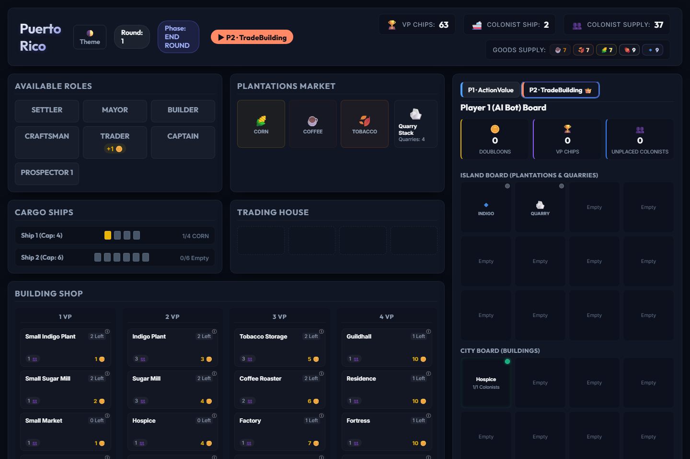

# Puerto Rico AI Competition

[](https://github.com/dae-hany/PuertoRico_AI_Competition/actions/workflows/tests.yml)
[](https://colab.research.google.com/github/dae-hany/PuertoRico_AI_Competition/blob/main/examples/first_agent.ipynb)

[한국어](README.ko.md)

An AI competition built on Puerto Rico, an economic strategy board game
proposed as a reinforcement-learning and game-AI benchmark. You write an agent,
it plays full games against other agents, and a tournament ranks everyone.

The competition has two independent tracks, each with its own leaderboard:

- **2p track**: 1-vs-1 (2-player) Puerto Rico.
- **3p track**: 3-player Puerto Rico.

You may enter either track or both. Each track takes a separate submission,
because, among other things, the observation length differs (225 in 2p, 298 in
3p). The rules, the engine, and the action space are otherwise shared.

The competition running now is the final project of the Reinforcement Learning
course at Chonnam National University (2p track, autumn 2026). If you are taking
the course, see [docs/COURSE_CNU_2026.md](docs/COURSE_CNU_2026.md)
([한국어](docs/COURSE_CNU_2026.ko.md)). A public IEEE CoG 2027 edition is planned
on the same engine and the same technical rules, and its dates will be announced
here. The engine, the agents, and the docs are in English so that anyone can take
part. The engine is a standard [PettingZoo](https://pettingzoo.farama.org/) AEC
environment (`puerto_rico/env.py`), so multi-agent RL tooling can drive it
directly.

**New here?** Start with the notebook
[`examples/first_agent.ipynb`](examples/first_agent.ipynb) (open it in Colab
with the badge above). In about ten minutes, with nothing installed, you write
an agent, play it against the baselines, and replay a game.

> Why a competition? Puerto Rico is easy to simulate but hard to master.
> Hand-written heuristics, tree search, and self-play reinforcement learning all
> play it, at the strengths measured in [docs/BASELINES.md](docs/BASELINES.md).
> The challenge is to build something that beats them.



## Quickstart

```bash
git clone https://github.com/dae-hany/PuertoRico_AI_Competition.git
cd PuertoRico_AI_Competition
python -m venv .venv && . .venv/bin/activate     # Windows: .venv\Scripts\activate
pip install -e .                        # installs deps + makes the packages importable
pip install -e ".[webui]"               # optional: flask, for the browser UI
pip install -e ".[rl]"                  # optional: PyTorch, for the PPO baseline

python examples/play_one_game.py        # one baseline game per track (2p and 3p)
python tools/play.py --agent submissions/example_agent.py:ExampleAgent   # an agent vs the baselines
python tools/validate_submission.py submissions/example_agent.py         # the official sandbox check
python examples/run_tournament.py       # a round-robin + leaderboard for each track
python webui/server.py                  # browser UI: play / watch / debug (webui extra)
# then open http://127.0.0.1:5000/?players=2&seats=actionvalue,trade to watch two bots play
```

`pip install -e .` is the recommended install: it makes `agents`, `tournament`,
and `puerto_rico` importable from anywhere. `pip install -r requirements.txt` also
works: the example scripts add the repo root to the path themselves, but you
then have to run them from the repo root.

## Write an agent

Subclass `Agent` and implement one method:

```python
import numpy as np
from agents.base import Agent

class MyAgent(Agent):
    name = "MyAgent"

    def act(self, observation, action_mask):
        # observation: float32[225] in 2p / [298] in 3p  |  action_mask: int[200] (1 = legal)
        legal = np.where(action_mask > 0.5)[0]
        return int(legal[0])            # replace with your strategy
```

The action space is the same in both tracks, and only the observation length
differs (`len(observation)` tells you which track you are in). Agents that read
the mask or the `forward_model`, as every baseline below does, work in both. PPO
reads neither, so it ships one checkpoint per track instead. Besides the moves
of each role, your agent decides whether to take each optional benefit (the
Mayor's and the Captain's privileges, the Hospice and University colonists, the
Harbor VP). At those decisions only `170` (accept) and `171` (decline) are
legal. See [Observation & action encoding](docs/OBSERVATION_AND_ACTIONS.md).

Copy [`submission_template/`](submission_template/) to get started, then read the
[Submission guide](docs/SUBMISSION_GUIDE.md).

## Test and validate your agent

```bash
python tools/play.py --agent my_agent.py:MyAgent                        # vs ActionValue and TradeBuilding
python tools/play.py --agent my_agent.py:MyAgent --vs Search --games 20 # win rate, VP margin, ms per move
python tools/play.py --agent my_agent.py:MyAgent --players 3 --vs all --record
python tools/validate_submission.py my_agent.py:MyAgent                 # plays inside the official sandbox
```

`play.py` plays seat-rotated games under the competition rules and prints, per
opponent, your win rate, mean VP margin, and per-move time, so you can see how
close you are to the 0.1 s budget. `validate_submission.py` runs your file the
way the official run does, in its own process that is killed at the deadline. It
prints a PASS / WARN / FAIL checklist (imports, name, timeouts, illegal moves)
and exits with status 0 when the entry is ready. `tools/replay_game.py` replays
any recorded game move by move (`--record`, or any game played in the web UI).

## Baselines

| Agent | Type | Track |
|---|---|---|
| `PpoAgent` | PPO self-play (RL), greedy | both, one checkpoint per track |
| `SearchAgent` | alpha‑beta search, 1500‑node budget | 2p (reactive fallback in 3p) |
| `SearchLiteAgent` | the same search, 250‑node budget | 2p (reactive fallback in 3p) |
| `MctsAgent` | Max^N UCT tree search, 60 simulations | both |
| `ActionValueAgent` | greedy heuristic: scores each legal action, plays the best | both |
| `ShippingRushAgent` | shipping-focused heuristic | both |
| `TradeBuildingAgent` | trade → building heuristic | both |
| `FactoryAgent` | Factory-engine heuristic | both |
| `RandomAgent` | uniform random legal move | both |

How strong each one is: see [`docs/BASELINES.md`](docs/BASELINES.md). The
numbers there are measured, regenerated by `python tools/measure_baselines.py`
whenever a baseline or a rule changes, and kept in that file only. Per track,
it has the round-robin of the heuristics and each planner (and PPO) against
each heuristic, plus, in 2p, PPO against each search baseline. Check the track
you are entering, because the two tracks need not rank the agents alike.

A search agent's strength is defined only at a stated compute budget, so the
budgets are quoted with the numbers. `SearchAgent`'s budget is a node count
rather than a clock, so it plays the same move on any hardware. The numbers
hold under the 0.1 s rule. That rule applies to entries, and the bundled
baselines keep their own 1 s budget without coming near it (`Search`'s slowest
measured move took ≈ 0.3 s), so these are the opponents your entry meets.

The heuristic baselines work with any player count, and so does `MctsAgent`
(it sizes its Max^N value vectors from the game it is handed). `SearchAgent`
and `SearchLiteAgent` search the 1‑vs‑1 game and fall back to a reactive
heuristic in a 3p game. `PpoAgent` plays both tracks with one checkpoint each.
Both checkpoints were trained with the same command and default settings: 5M
steps of self-play each, about 2 h each on 8 CPU threads. See
[`training/README.md`](training/README.md), and
[`examples/ppo_entry/`](examples/ppo_entry/) for an entry built on the 2p one.

### Recommended approach for the 2p track

Puerto Rico 1‑vs‑1 is a two-player, winner-takes-all (≈ zero-sum),
near‑perfect‑information game: the only hidden state is the face-down
plantation draw order. Both a learned policy (the `PPO` baseline) and
adversarial search, the classic tool for this kind of game, work here
([BASELINES.md](docs/BASELINES.md) has the two against each other). The two
also combine, for example a policy or value network that guides or cuts off a
search ([`examples/ppo_entry/`](examples/ppo_entry/) is the learned starting
point). `SearchAgent` is a readable alpha‑beta reference to play against, study,
and improve. Its strength is set by a node budget rather than wall-clock time,
so it plays the same move on any hardware, which makes it fair to compare
against. At 1500 nodes it needs more than an entrant's 0.1 s per decision. As a
bundled baseline it keeps its own 1 s budget, but an entry built on it must use
fewer nodes. [docs/SEARCH_BASELINE_2P.md](docs/SEARCH_BASELINE_2P.md) explains
how it works and ranks concrete ways to make it stronger.

## Repository layout

```
puerto_rico/        core game engine + environment + forward model
agents/             the Agent interface and all baseline agents
tournament/         single-match harness, round-robin runner, rankers, leaderboard
                    (sandbox.py runs each entrant in its own process: the
                     official run's time limit and anti-tampering guarantees)
training/           optional PPO self-play trainer + the bundled RL checkpoints (2p, 3p)
webui/              browser UI to play, watch, and debug agents
examples/           first_agent.ipynb (Colab), play_one_game.py, run_tournament.py,
                    ppo_entry/ (a learned 2p entry with its weight file)
tools/              play.py (your agent vs the baselines), validate_submission.py
                    (the official sandbox check), replay_game.py, run_ladder.py
                    (organizer: one ladder round), course_ladder.py (organizer:
                    a course cohort with zip intake, a fixed seed list, parallel
                    games, and a wins-and-rank board), make_private_seeds.py,
                    bench2p.py, bench_engine.py, measure_baselines.py
leaderboard/        ladder standings and replays, published during the window
submission_template/ copy this to build your competition entry
submissions/        drop an agent here to debug it in the web UI
docs/               rules, observation/action encoding, ranking, submission guide
tests/              pytest suite
```

## The competition

- **Format.** Two tracks, 2p and 3p, with one agent file per track (plus at most
  one weight file of up to 50 MB for a learned agent) and 0.1 s per decision.
  Each track is a seat-balanced round-robin of every entry against every other
  entry and the bundled baselines, ranked by Elo (2p) or TrueSkill (3p). The
  rules are in [docs/COMPETITION_RULES.md](docs/COMPETITION_RULES.md).
- **Running now: the course edition.** The 2p track is the final project of the
  Reinforcement Learning course at Chonnam National University (autumn 2026).
  The course adds its own rules: ranking by wins and rank in games between
  students, a code zip plus a separate zip for the report and presentation, and
  four ladder rounds that publish only wins and rank. They are in
  [docs/COURSE_CNU_2026.md](docs/COURSE_CNU_2026.md), which takes precedence
  for students of that course. The course is graded with Python 3.12 and
  CPU-only PyTorch 2.15, one thread per agent, 32 games at a time. The machine
  and the other details are under
  [Grading environment](docs/COURSE_CNU_2026.md#grading-environment).
- **Window.** The competition runs for about three months. The dates of the
  IEEE CoG 2027 edition will be announced here.
- **Weekly ladder.** During the window the organizer runs every entry received
  so far (`tools/run_ladder.py`) and publishes the standings and every game's
  replay under [`leaderboard/`](leaderboard/). Submit early, watch your rank,
  and resubmit as often as you like. The last file received before the deadline
  is the one that counts.
- **How to submit.** To be announced with the dates (CNU course students submit
  through the LMS, as described on the course page). Until then, send questions
  and bug reports to the
  [issue tracker](https://github.com/dae-hany/PuertoRico_AI_Competition/issues).

## How ranking works

Each track is ranked separately, with its own round-robin and leaderboard. The
official metric is a skill rating chosen for the track, Elo in the 2p (1‑vs‑1)
track and TrueSkill in the 3p track, computed over a seat-balanced round-robin.
The win rate (Wilson 95% CI) is shown alongside. α‑Rank is available as opt‑in
analysis and is not part of the standings. See [Ranking](docs/RANKING.md).
[`docs/BASELINES.md`](docs/BASELINES.md) shows both boards over the bundled
heuristics (Elo in 2p, TrueSkill in 3p) with win rates alongside.

## Documentation

- [Game rules](docs/GAME_RULES.md)
- [Baseline strengths](docs/BASELINES.md): measured, per track
- [Observation & action encoding](docs/OBSERVATION_AND_ACTIONS.md)
- [Competition rules](docs/COMPETITION_RULES.md)
- [Submission guide](docs/SUBMISSION_GUIDE.md)
- [Ranking](docs/RANKING.md)
- [Changes that affect results](CHANGES.md)

## Tests

```bash
pip install pytest
python -m pytest tests/ -q
```

## License

Code is released under the [MIT License](LICENSE). The board game *Puerto Rico*
(designer Andreas Seyfarth) is the intellectual property of its rights holders.
This is an independent, non-commercial re-implementation for education and
research, with no original artwork. See [LICENSE](LICENSE) for the full notice.
